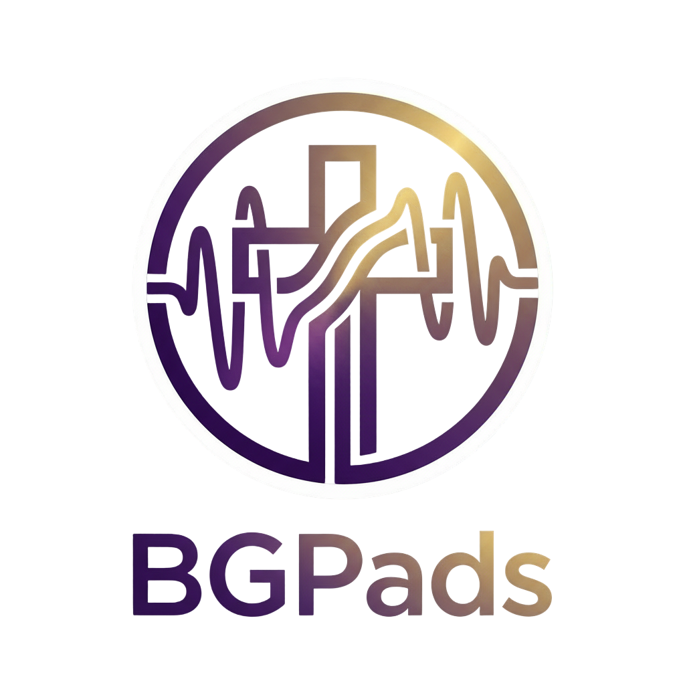
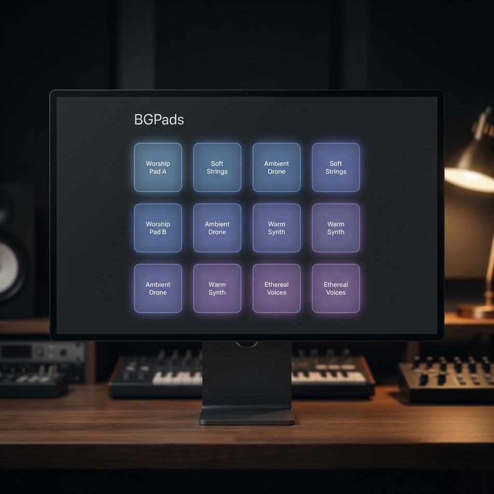

# BGPads

  
   
  <h3>Ambient Audio Pads for Worship</h3>
  
Una aplicación profesional para la gestión de pads y ambientes en contextos de iglesia.

---

## 📋 Descripción

**BGPads** es una aplicación de escritorio diseñada específicamente para músicos y directores de alabanza. Permite disparar secuencias de audio, pads y ambientes de forma fluida, con transiciones suaves (crossfade) y un control total sobre la mezcla.

Pensada para ser utilizada en **contextos de iglesia**, su interfaz es limpia, oscura y libre de distracciones, permitiendo al usuario concentrarse en lo más importante: la adoración.

## 👤 Autor

**Esteban Rosano**
- Desarrollo y Diseño
- © 2024

## 🚀 Tecnologías

Este proyecto está construido con tecnologías web modernas encapsuladas en una aplicación de escritorio robusta:

- **Electron**: Framework para aplicaciones de escritorio multiplataforma.
- **React**: Biblioteca para construir interfaces de usuario dinámicas.
- **TypeScript**: Superset de JavaScript para un código más seguro y escalable.
- **Vite**: Build tool de próxima generación para un desarrollo rápido.
- **Web Audio API**: Motor de audio de baja latencia para reproducción y efectos.

## ✨ Características Principales

### 🎛️ Control de Audio Profesional
- **Crossfade Automático**: Transiciones suaves entre pistas con duración configurable (0-10s).
- **Fade-out al Detener**: El audio se desvanece suavemente al detenerse, evitando cortes bruscos.
- **Volumen Independiente**: Ajusta el volumen de cada pista individualmente (hasta 300% de ganancia).
- **Metrónomo Avanzado**:
  - Configuración individual por pad (BPM y compás).
  - Acentos interactivos personalizables (frecuencia, decaimiento y volumen independientes).
  - Persistencia inteligente del tempo basándose en el último pad activo.

### 🎨 Diseño y Personalización Total
- **Menú Contextual Moderno**: Ajustes completamente renovados con sliders personalizados, agrupamiento inteligente y paletas de colores.
- **Indicadores en Tiempo Real**: Visualización del progreso de reproducción y asignación de índice por pad.
- **Temas**: Modo Claro y Oscuro para adaptarse a cualquier entorno de iluminación.
- **Interfaz Inmersiva**: Maximización por defecto y diseño adaptativo que envuelve toda la pantalla.
- **Colores Personalizables**: Asigna colores únicos o mediante presets a cada pad para una rápida identificación visual.

### ⌨️ Flujo de Trabajo y Rendimiento
- **Carga de Pistas Dinámica**: Carga asíncrona e individual con indicadores de carga (spinners), eliminando pantallas de bloqueo.
- **Gestión de Pistas**: Importación y exportación de tus configuraciones y listas de reproducción directamente desde el menú.
- **Atajos de Teclado**: Asigna teclas a tus pads rápidamente desde la nueva interfaz.
- **Optimización y Resiliencia**: Uso mejorado de recursos y recuperación ante fallo de directorios (manejo de carpetas de recursos faltantes).
- **Persistencia Automática**: Configuraciones, pistas añadidas y preferencias se guardan para la próxima sesión de manera eficiente.

### 🌍 Internacionalización
- **Multi-idioma**: Soporte de traducciones completo para Español e Inglés en toda la aplicación.

## 🎥 Demostración

> *Aquí se incluirán videos explicativos sobre el uso de la herramienta, configuración de atajos y gestión de archivos.*

1. **Agregando Audio**: Ve a `Archivo > Agregar Audio` y selecciona tus MP3s.
2. **Configurando Crossfade**: Ajusta el slider en `Archivo > Preferencias`.
3. **Asignando Teclas**: Click derecho en un pad > Click en el icono de teclado > Presiona tu tecla.

---

  Construido con ❤️ para la iglesia.

